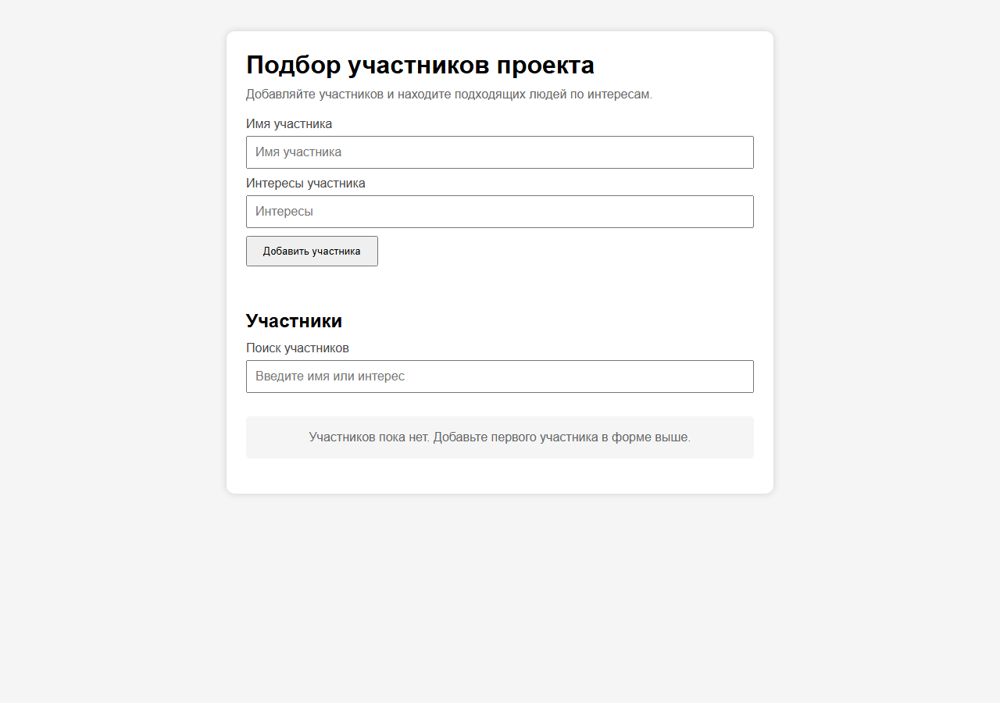

# Подбор участников проекта

[](https://github.com/xxstevexxds/Kolosov-rabota/actions/workflows/ci.yml)

Небольшое браузерное приложение для ведения списка участников проекта и поиска людей по интересам. Данные сохраняются локально в браузере, сервер и регистрация не требуются.



## Возможности

- добавление и удаление участников;
- проверка пустых полей и повторяющихся имён;
- поиск по имени или интересам без учёта регистра;
- автоматическое сохранение и восстановление данных из `localStorage`;
- понятные сообщения, пустое состояние и управление клавишей Enter.

## Требования

- современный браузер;
- Node.js 24 или новее — только для запуска проверок;
- npm, входящий в поставку Node.js.

Сторонние зависимости отсутствуют.

## Установка

```bash
git clone https://github.com/xxstevexxds/Kolosov-rabota.git
cd Kolosov-rabota
npm ci
```

## Запуск

Откройте файл `index.html` в браузере. Сборка и локальный сервер не требуются.

## Тесты

```bash
npm test
```

Команда проверяет синтаксис файлов `logic.js` и `script.js`, затем запускает шесть автоматических тестов через встроенный модуль `node:test`. Та же команда выполняется в GitHub Actions при push и pull request.

## Хранение данных

Список участников хранится в `localStorage` текущего браузера под ключом `users`. Повреждённые данные безопасно заменяются пустым списком.

## Структура

```text
.
├── .github/workflows/ci.yml  # автоматическая проверка
├── docs/interface.png        # скриншот интерфейса
├── tests/logic.test.js       # автоматические тесты
├── index.html                # разметка приложения
├── style.css                 # оформление
├── logic.js                  # тестируемая логика
├── script.js                 # работа интерфейса
├── package.json              # команда проверки
└── package-lock.json         # зафиксированная установка
```

## Ограничения

- данные доступны только в браузере и профиле, где были созданы;
- синхронизация между устройствами отсутствует;
- приложение не выполняет автоматический подбор команды и не оценивает совместимость участников;
- экспорт и импорт данных не реализованы.

## Лицензия

Отдельная лицензия на использование и распространение кода не предоставлена.
